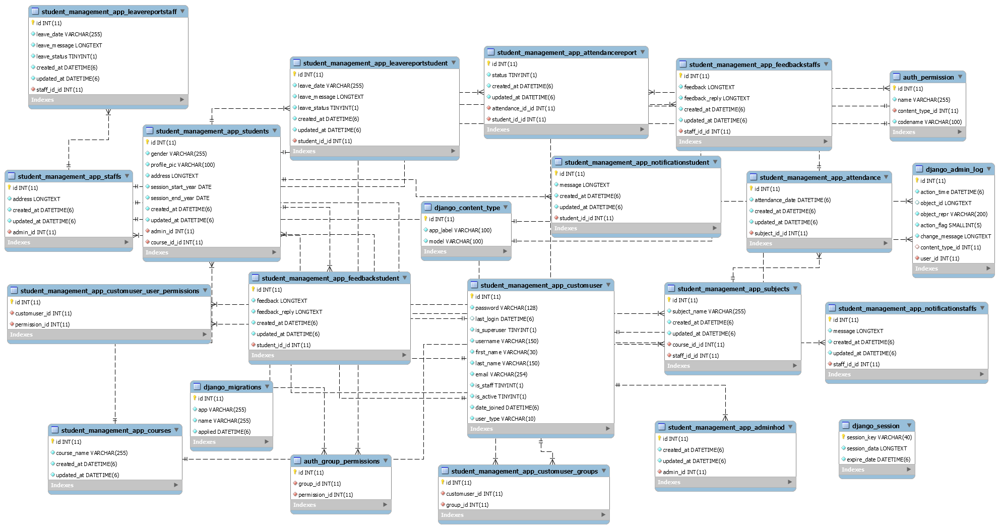

# Student Management System

A Django web application for running a school or department's records: one place where the head of department manages staff, students, courses and subjects, and where staff and students each have their own dashboard.


## Features

- **Three roles, three dashboards.** Head of department (HOD), staff and students each sign in to their own interface. A middleware sends every user to the pages for their role.
- **Sign in with email.** A custom authentication backend logs users in with their email address instead of a username.
- **HOD administration.** Add, edit and list staff, students, courses and subjects.
- **Profiles created automatically.** Creating a user creates the matching HOD, staff or student profile (Django signals).
- **Database ready for the next features.** Models for attendance, leave requests, feedback and notifications for staff and students.
- **Configurable database.** SQLite for development, MySQL through environment variables.

## Database design



The schema is also available as [database.sql](database.sql) and [database.pdf](database.pdf).

## Tech stack

| Layer | Technology |
|---|---|
| Backend | Python, Django 5.2 |
| Database | SQLite (default), MySQL (optional) |
| Frontend | Django templates, Bootstrap, AdminLTE, JavaScript |

## Getting started

Requirements: Python 3.10 or newer, Git, pip.

```bash
git clone https://github.com/Ebisa-Ajema/Student-management-system.git
cd Student-management-system
python3 -m venv .venv
source .venv/bin/activate          # Windows: .venv\Scripts\activate
pip install -r requirements.txt
python manage.py migrate
python manage.py createsuperuser   # this account becomes the HOD
python manage.py runserver
```

Open http://127.0.0.1:8000 and sign in with the superuser's **email** and password.

### Settings

| Variable | Default | Purpose |
|---|---|---|
| `DJANGO_SECRET_KEY` | development key | Secret key; always set it outside development |
| `DJANGO_DEBUG` | `True` | Set to `False` in production |
| `DB_ENGINE` | SQLite | Set to `mysql` to use MySQL |
| `DB_NAME`, `DB_USER`, `DB_PASSWORD`, `DB_HOST`, `DB_PORT` | | MySQL connection (needs the `mysqlclient` package) |

## Project structure

```
student_management_app/
  models.py                 users, profiles, courses, subjects, attendance, leave, feedback, notifications
  HodViews.py               HOD pages: staff, students, courses, subjects
  StaffViews.py             staff dashboard
  StudentViews.py           student dashboard
  EmailBackEnd.py           email login
  LoginCheckMiddleWare.py   keeps each role on its own pages
  templates/                hod_template/, staff_template/, student_template/
student_management_system/  settings and URLs
static/                     Bootstrap, AdminLTE and plugins
```

## Roadmap

- Attendance taking and reports for staff
- Leave requests and approval
- Feedback and notifications between students, staff and the HOD

## Author

**Ebisa Ajema**, Software Engineering graduate, Adama Science and Technology University.
[GitHub](https://github.com/Ebisa-Ajema) · [Portfolio](https://ebisa-ajema.github.io/my-portofolio/)
